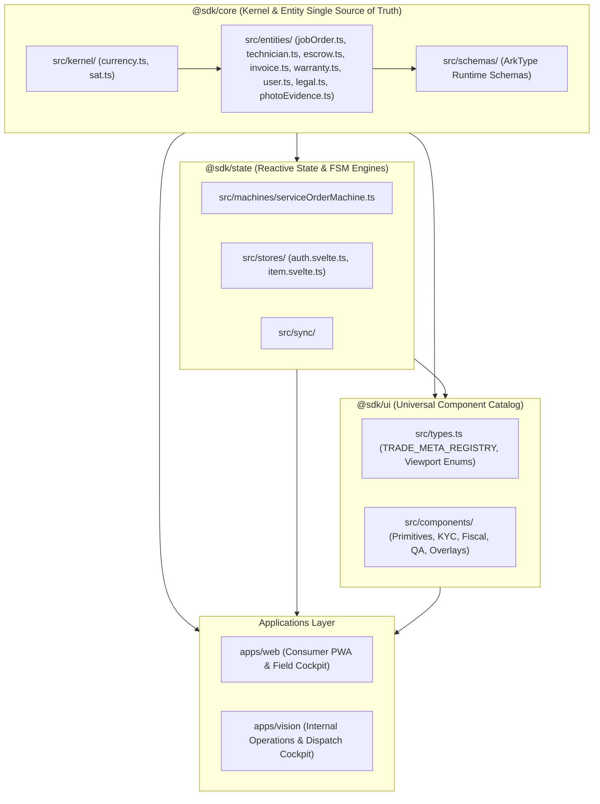

# `COMPONENTS.md` — Yessyfy Unified Type System & Component Specification Catalog

```
   ██╗   ██╗███████╗███████╗███████╗██╗   ██╗███████╗██╗   ██╗
   ╚██╗ ██╔╝██╔════╝██╔════╝██╔════╝╚██╗ ██╔╝██╔════╝╚██╗ ██╔╝
    ╚████╔╝ █████╗  ███████╗███████╗ ╚████╔╝ █████╗   ╚████╔╝ 
     ╚██╔╝  ██╔══╝  ╚════██║╚════██║  ╚██╔╝  ██╔══╝    ╚██╔╝  
      ██║   ███████╗███████║███████║   ██║   ██║        ██║   
      ╚═╝   ╚══════╝╚══════╝╚══════╝   ╚═╝   ╚═╝        ╚═╝   
   UNIFIED TYPE SYSTEM & COMPONENT SPECIFICATION CATALOG (SVELTE 5 + DAISYUI v5)
```

---

## 1. Unified Type System Architecture

### 1.1 Single Source of Truth (SSOT) Layering & Dependency Topology



### 1.2 Anti-Duplication Enforcement Rules
1. **Forbidden Duplication**: No TypeScript `type` or `interface` defined in `@sdk/core` shall be redefined or copied into `@sdk/ui`, `apps/web`, or `apps/vision`.
2. **Currency Arithmetic Guard**: Floating-point arithmetic on Mexican Pesos is strictly illegal. All monetary calculations must use branded `Centavos` and pure integer kernel operations (`toCentavos`, `addCentavos`, `subtractCentavos`, `multiplyCentavos`, `percentageCentavos`).
3. **State Machine Context Alignment**: All FSM context interfaces (`ServiceOrderContext`, `ServiceOrderEvent`) in `@sdk/state` derive directly from `@sdk/core` entity types.
4. **Export Pathing**: Everything in `@sdk/core` is exported via `@sdk` or `@sdk/core`. `@sdk/ui` exports all components and visual metadata.

---

### 1.3 Canonical TypeScript Interfaces

```typescript
// ============================================================================
// @sdk/core/src/kernel/currency.ts
// ============================================================================

export type Centavos = number & { readonly __brand: unique symbol };

export function toCentavos(pesos: number): Centavos;
export function fromCentavos(cents: number): number;
export function formatMxn(cents: number): string;
export function addCentavos(a: number, b: number): Centavos;
export function subtractCentavos(a: number, b: number): Centavos;
export function multiplyCentavos(cents: number, factor: number): Centavos;
export function percentageCentavos(cents: number, percentage: number): Centavos;

// ============================================================================
// @sdk/core/src/entities/user.ts
// ============================================================================

export type UserRole =
  | "customer"
  | "collaborator"
  | "operator"
  | "admin"
  | "owner"
  | "user";

export type UserStatus = "active" | "suspended" | "banned" | "pending_kyc";

export interface User {
  id: string;
  email?: string;
  phone?: string;
  username?: string;
  fullName?: string;
  role: UserRole;
  status?: UserStatus;
  rfc?: string;
  curp?: string;
  avatarUrl?: string;
  locale?: string;
  createdAt?: string;
  updatedAt?: string;
}

export interface AuthUser {
  id: string;
  phone: string;
  role: UserRole;
  fullName?: string;
  token?: string;
}

// ============================================================================
// @sdk/core/src/entities/technician.ts
// ============================================================================

export type TradeCategory =
  | "plomeria"
  | "electricidad"
  | "cerrajeria"
  | "jardineria"
  | "mantenimiento_hogar"
  | "albanileria";

export type KycStatus = "unsubmitted" | "submitted" | "verified" | "rejected";

export type OperationalState =
  | "offline"
  | "idle"
  | "dispatched"
  | "on_job"
  | "suspended";

export interface KycDocuments {
  ineFrontUrl?: string;
  ineBackUrl?: string;
  selfieUrl?: string;
  proofAddressUrl?: string;
  taxSituationUrl?: string;
}

export interface TechnicianRecord {
  id: string;
  userId: string;
  user?: User;
  trades: TradeCategory[];
  kycStatus: KycStatus;
  kycDocuments: KycDocuments;
  clabe?: string;
  operationalState: OperationalState;
  currentLocation?: Coordinates;
  ratingAvg: number;
  jobsCompleted: number;
  cancellationRate: number;
  updatedAt: string;
}

// ============================================================================
// @sdk/core/src/entities/jobOrder.ts
// ============================================================================

export type ServiceCategory = TradeCategory;
export type LocationType = "residencial" | "comercial" | "premium";
export type UrgencyLevel = "normal" | "mismo_dia" | "emergencia_24_7";

export type JobOrderStatus =
  | "draft"
  | "pending_triage"
  | "dispatched"
  | "accepted"
  | "in_transit"
  | "en_camino"
  | "in_progress"
  | "pending_quote_approval"
  | "winding_down"
  | "pending_validation"
  | "validated"
  | "completed"
  | "disputed"
  | "cancelled";

export interface Coordinates {
  lat: number;
  lng: number;
  latitude?: number;
  longitude?: number;
}

export interface JobOrder {
  id: string;
  code: string; // YSF-YYYY-XXXXX
  customerId: string;
  customer?: User;
  collaboratorId?: string;
  collaborator?: User;
  category: ServiceCategory;
  locationType: LocationType;
  urgency: UrgencyLevel;
  status: JobOrderStatus;
  coordinates: Coordinates;
  addressText: string;
  postalCode: string;
  description: string;

  // Scheduling & Access
  scheduleDate?: string;
  scheduleTimeSlot?: string;
  gateSecurityInstructions?: string;
  clientSignatureUrl?: string;

  // Financial values in integer centavos (MXN)
  baseBudgetCents: number;
  supplementalCents: number;
  totalCustomerCents: number;
  platformFeeCents: number;
  collaboratorGrossCents: number;
  isrWithheldCents: number;
  ivaWithheldCents: number;
  collaboratorNetCents: number;
  tipCents?: number;

  // Rating & Review
  rating?: number;
  reviewText?: string;

  // SAT CFDI 4.0 Metadata
  cfdiFolio?: string;
  cfdiXmlUrl?: string;
  cfdiPdfUrl?: string;
  cfdiRfc?: string;
  cfdiRazonSocial?: string;
  cfdiPostalCode?: string;
  cfdiRegimen?: string;
  cfdiUso?: string;

  createdAt: string;
  scheduledFor?: string;
  dispatchedAt?: string;
  arrivedAt?: string;
  completedAt?: string;
}

// ============================================================================
// @sdk/core/src/kernel/sat.ts
// ============================================================================

export interface PricingModifiers {
  locationType: LocationType;
  urgency: UrgencyLevel;
}

export interface JobFinancialBreakdown {
  baseBudgetCents: Centavos;
  supplementalCents: Centavos;
  totalCustomerCents: Centavos;
  platformFeeCents: Centavos;
  gatewayFeeCents: Centavos;
  collaboratorGrossCents: Centavos;
  isrWithheldCents: Centavos;
  ivaWithheldCents: Centavos;
  totalWithholdingsCents: Centavos;
  collaboratorNetCents: Centavos;
  platformContributionCents: Centavos;
}

export interface PriceBreakdownData {
  baseBudgetCents: number;
  supplementalCents?: number;
  totalCustomerCents: number;
  platformFeeCents: number;
  isrWithheldCents: number;
  ivaWithheldCents: number;
  collaboratorNetCents: number;
  isMember?: boolean;
}

// ============================================================================
// @sdk/core/src/entities/escrow.ts
// ============================================================================

export type EscrowAccountType =
  | "customer_funds_payable"
  | "escrow_transit"
  | "platform_commission_income"
  | "gateway_expense"
  | "sat_tax_payable"
  | "collaborator_payable"
  | "dispute_reserve";

export interface EscrowAccount {
  id: string;
  accountType: EscrowAccountType;
  balanceCents: number;
  currency: string;
  updatedAt: string;
}

export interface EscrowEntry {
  id: string;
  transactionId: string;
  idempotencyKey: string;
  jobOrderId?: string;
  debitAccountId: string;
  creditAccountId: string;
  amountCents: number;
  memo: string;
  createdAt: string;
}

// ============================================================================
// @sdk/core/src/entities/warranty.ts
// ============================================================================

export type WarrantyStatus =
  | "active"
  | "claimed"
  | "serviced"
  | "voided"
  | "expired";

export interface WarrantyCertificate {
  id: string;
  certificateNumber: string; // YSF-WAR-XXXXX
  jobOrderId: string;
  customerId: string;
  collaboratorId: string;
  validFrom: string;
  validUntil: string; // validFrom + 30 days
  status: WarrantyStatus;
  termsHash: string;
  createdAt: string;
}

// ============================================================================
// @sdk/core/src/entities/invoice.ts
// ============================================================================

export type CfdiType = "ingreso_comision" | "retencion_plataforma";

export interface TaxInvoice {
  id: string;
  jobOrderId: string;
  cfdiType: CfdiType;
  uuid: string; // SAT Fiscal UUID
  rfcEmisor: string;
  rfcReceptor: string;
  totalCents: number;
  xmlUrl: string;
  pdfUrl: string;
  pacResponseCode?: string;
  stampedAt: string;
  createdAt: string;
}

// ============================================================================
// @sdk/core/src/entities/photoEvidence.ts
// ============================================================================

export type PhotoQAPhase =
  | "diagnostic_before"
  | "work_progress"
  | "proof_finished";

export interface PhotoQAEvidence {
  id: string;
  jobOrderId: string;
  phase: PhotoQAPhase;
  imageUrl: string;
  thumbnailUrl: string;
  sha256Checksum: string;
  capturedAt: string;
  capturedLocation?: Coordinates;
  verifiedByOps: boolean;
  opsReviewerId?: string;
  createdAt: string;
}

// ============================================================================
// Additional Canonical Contracts (Booking, Chat, Review)
// ============================================================================

export interface BookingDetails {
  category: ServiceCategory;
  locationType: LocationType;
  urgency: UrgencyLevel;
  totalCents: number;
  scheduleDate: string;
  scheduleTimeSlot: string;
  addressText: string;
  postalCode: string;
  gateInstructions: string;
}

export interface ReviewSubmission {
  rating: number;
  tags: string[];
  tipCents: number;
  signatureDataUrl: string;
  comment: string;
}

export interface ChatMessage {
  id: string;
  jobCode: string;
  senderId: string;
  senderRole: "client" | "collaborator" | "system" | "ops";
  senderName: string;
  body: string;
  timestamp: string;
  maskedPhoneDetected?: boolean;
}
```

---

## 2. Tagged Component Specification Catalog

### Category 1: Primitives & Micro-States

---

#### `COMP-01: StatusBadge.svelte`
- **[ID & Name]**: `COMP-01: StatusBadge.svelte`
- **[Category]**: Primitive
- **[Surface & Role]**: Universal (Consumer PWA, Field Cockpit, Vision CRM)
- **[Inputs / Props Contract]**:
  ```typescript
  interface Props {
    status?: JobOrderStatus;
    escrowStatus?: 'retained' | 'released' | 'disputed';
    urgency?: UrgencyLevel;
    size?: 'xs' | 'sm' | 'md' | 'lg'; // default: 'md'
  }
  ```
- **[Outputs / Event Callbacks]**: None (Presentational badge).
- **[Slots / Snippets]**: `children?: Snippet` (Optional suffix / icon override).
- **[Reactive State / Runes]**:
  - `const config = $derived(() => { ... })`: Evaluates priority between `escrowStatus` > `urgency` > `status` to return label, DaisyUI badge class, and pulse indicator flag.
- **[DaisyUI v5 Formula]**:
  ```svelte
  <span class="badge {config().badgeClass} inline-flex items-center gap-1.5 font-medium {sizeClass}">
    {#if config().pulse}
      <span class="relative flex h-2 w-2">
        <span class="animate-ping absolute inline-flex h-full w-full rounded-full opacity-75 bg-current"></span>
        <span class="relative inline-flex rounded-full h-2 w-2 bg-current"></span>
      </span>
    {/if}
    {config().label}
  </span>
  ```
- **[Tactile / Audio / Ergonomics]**: Passive visual pill; pulse animation restricted to live in-transit and active escrow states.
- **[Invariants & Failure Modes]**: Fallback to `{ label: 'Estado', badgeClass: 'badge-ghost', pulse: false }` if no state prop is supplied.

---

#### `COMP-02: StarRating.svelte`
- **[ID & Name]**: `COMP-02: StarRating.svelte`
- **[Category]**: Primitive
- **[Surface & Role]**: Universal (Review Sheet, Technician Card, Directory)
- **[Inputs / Props Contract]**:
  ```typescript
  interface Props {
    value?: number; // default: 5 (1 to 5)
    readonly?: boolean; // default: false
    size?: 'xs' | 'sm' | 'md' | 'lg'; // default: 'md'
    name?: string; // default: 'rating-star'
    onChange?: (val: number) => void;
  }
  ```
- **[Outputs / Event Callbacks]**: `onChange?: (val: number) => void`
- **[Slots / Snippets]**: `label?: Snippet<[{ value: number }]>`
- **[Reactive State / Runes]**:
  - `let current = $state(value);`
  - `$effect(() => { current = value; })`
- **[DaisyUI v5 Formula]**:
  ```svelte
  <div class="rating {size === 'xs' ? 'rating-xs' : size === 'sm' ? 'rating-sm' : size === 'lg' ? 'rating-lg' : 'rating-md'}">
    {#each [1, 2, 3, 4, 5] as star}
      <input
        type="radio"
        name={name}
        class="mask mask-star-2 bg-warning transition-transform active:scale-125"
        checked={current === star}
        disabled={readonly}
        onchange={() => { current = star; onChange?.(star); }}
      />
    {/each}
  </div>
  ```
- **[Tactile / Audio / Ergonomics]**: On selection, subtle haptic feedback (`navigator.vibrate?.(20)`), 48px interactive target per star on touch devices.
- **[Invariants & Failure Modes]**: Clamps `value` strictly between 1 and 5.

---

#### `COMP-03: Avatar.svelte`
- **[ID & Name]**: `COMP-03: Avatar.svelte`
- **[Category]**: Primitive
- **[Surface & Role]**: Universal
- **[Inputs / Props Contract]**:
  ```typescript
  interface Props {
    src?: string;
    name: string;
    size?: 'xs' | 'sm' | 'md' | 'lg' | 'xl'; // default: 'md'
    shape?: 'rounded' | 'squircle' | 'circle'; // default: 'squircle'
    statusIndicator?: 'online' | 'offline' | 'busy' | 'none'; // default: 'none'
  }
  ```
- **[Outputs / Event Callbacks]**: `onClick?: () => void`
- **[Slots / Snippets]**: `badge?: Snippet`
- **[Reactive State / Runes]**:
  - `const initials = $derived(name.split(' ').slice(0, 2).map(w => w[0]).join('').toUpperCase())`
  - `let imageFailed = $state(false)`
- **[DaisyUI v5 Formula]**:
  ```svelte
  <div class="avatar {statusIndicator === 'online' ? 'avatar-online' : statusIndicator === 'busy' ? 'avatar-offline' : ''} {imageFailed || !src ? 'avatar-placeholder' : ''}">
    <div class="{sizeClass} {shapeClass} bg-neutral text-neutral-content font-bold shadow-sm">
      {#if src && !imageFailed}
         imageFailed = true} />
      {:else}
        <span>{initials}</span>
      {/if}
    </div>
  </div>
  ```
- **[Tactile / Audio / Ergonomics]**: Smooth scale-up on tap when `onClick` is provided.
- **[Invariants & Failure Modes]**: Automatically falls back to high-contrast initials placeholder if image URL fails or 404s.

---

#### `COMP-04: Chip.svelte`
- **[ID & Name]**: `COMP-04: Chip.svelte`
- **[Category]**: Primitive
- **[Surface & Role]**: Universal (Filters, Trade Selector, Tags)
- **[Inputs / Props Contract]**:
  ```typescript
  interface Props {
    label: string;
    active?: boolean; // default: false
    removable?: boolean; // default: false
    color?: 'primary' | 'secondary' | 'accent' | 'neutral' | 'ghost'; // default: 'ghost'
    onSelect?: () => void;
    onRemove?: () => void;
  }
  ```
- **[Outputs / Event Callbacks]**: `onSelect?: () => void`, `onRemove?: () => void`
- **[Slots / Snippets]**: `icon?: Snippet`
- **[Reactive State / Runes]**: Stateless rune prop consumption.
- **[DaisyUI v5 Formula]**:
  ```svelte
  <button
    type="button"
    class="badge badge-lg gap-2 cursor-pointer transition-all border {active ? 'badge-primary text-white font-bold shadow' : 'badge-ghost bg-base-200/80 hover:bg-base-300 font-medium'}"
    onclick={onSelect}
  >
    {@render icon?.()}
    <span>{label}</span>
    {#if removable}
      <button type="button" class="btn btn-ghost btn-circle btn-xs -mr-1" onclick={(e) => { e.stopPropagation(); onRemove?.(); }}>✕</button>
    {/if}
  </button>
  ```
- **[Tactile / Audio / Ergonomics]**: 44px touch height target for mobile filters.
- **[Invariants & Failure Modes]**: StopPropagation on remove button prevents accidental filter selection trigger.

---

#### `COMP-05: TabBar.svelte`
- **[ID & Name]**: `COMP-05: TabBar.svelte`
- **[Category]**: Primitive
- **[Surface & Role]**: Universal (Cockpit views, Profile views, Admin views)
- **[Inputs / Props Contract]**:
  ```typescript
  export interface TabItem<T = string> {
    id: T;
    label: string;
    icon?: string;
    badge?: string | number;
  }
  interface Props<T = string> {
    tabs: TabItem<T>[];
    activeTab: T;
    variant?: 'boxed' | 'bordered' | 'lifted'; // default: 'boxed'
    onTabChange: (tabId: T) => void;
  }
  ```
- **[Outputs / Event Callbacks]**: `onTabChange: (tabId: T) => void`
- **[Slots / Snippets]**: None
- **[Reactive State / Runes]**: Stateless wrapper around generic props `<T>`.
- **[DaisyUI v5 Formula]**:
  ```svelte
  <div class="tabs {variant === 'boxed' ? 'tabs-box bg-base-200 p-1 rounded-2xl' : variant === 'lifted' ? 'tabs-lift' : 'tabs-border'}">
    {#each tabs as tab}
      <button
        type="button"
        class="tab font-bold {activeTab === tab.id ? 'tab-active' : ''}"
        onclick={() => onTabChange(tab.id)}
      >
        {#if tab.icon}<span class="mr-1.5">{tab.icon}</span>{/if}
        {tab.label}
        {#if tab.badge}
          <span class="badge badge-xs ml-1.5 {activeTab === tab.id ? 'badge-neutral' : 'badge-ghost'}">{tab.badge}</span>
        {/if}
      </button>
    {/each}
  </div>
  ```
- **[Tactile / Audio / Ergonomics]**: Keyboard accessible with arrow left/right tab navigation.
- **[Invariants & Failure Modes]**: Empty tabs array renders `null` gracefully.

---

#### `COMP-06: PretextText.svelte`
- **[ID & Name]**: `COMP-06: PretextText.svelte`
- **[Category]**: Primitive
- **[Surface & Role]**: Universal (Chat messages, Service Descriptions, Legal Disclaimers)
- **[Inputs / Props Contract]**:
  ```typescript
  interface Props {
    content: string;
    maskPhoneNumbers?: boolean; // default: true
    clampLines?: number; // default: 0 (unclamped)
    allowMarkdown?: boolean; // default: false
  }
  ```
- **[Outputs / Event Callbacks]**: `onMaskClick?: () => void`
- **[Slots / Snippets]**: None
- **[Reactive State / Runes]**:
  - `const parsed = $derived(() => { ... })`: Regex pattern matching for Mexican 10-digit telephone numbers replaced with `[Teléfono Oculto por Seguridad]` if `maskPhoneNumbers` is true.
- **[DaisyUI v5 Formula]**:
  ```svelte
  <div class="text-sm leading-relaxed whitespace-pre-wrap font-normal {clampLines > 0 ? `line-clamp-${clampLines}` : ''}">
    {#each parsed().segments as seg}
      {#if seg.isMasked}
        <span class="badge badge-warning badge-xs font-mono font-bold cursor-help" title="Por seguridad y garantía legal, el contacto directo está bloqueado.">
          🔒 {seg.text}
        </span>
      {:else}
        {seg.text}
      {/if}
    {/each}
  </div>
  ```
- **[Tactile / Audio / Ergonomics]**: Non-blocking tooltips on masked contacts.
- **[Invariants & Failure Modes]**: Replaces empty string with `"—"`.

---

### Category 2: Identity & KYC

---

#### `COMP-07: TechProfileCard.svelte`
- **[ID & Name]**: `COMP-07: TechProfileCard.svelte`
- **[Category]**: Identity & KYC
- **[Surface & Role]**: Consumer PWA, Field Cockpit, Vision CRM
- **[Inputs / Props Contract]**:
  ```typescript
  interface Props {
    technician: TechnicianRecord;
    showContactActions?: boolean; // default: false
    onCall?: () => void;
    onMessage?: () => void;
  }
  ```
- **[Outputs / Event Callbacks]**: `onCall?: () => void`, `onMessage?: () => void`
- **[Slots / Snippets]**: `actions?: Snippet`
- **[Reactive State / Runes]**:
  - `const tradeMetas = $derived(technician.trades.map(t => TRADE_META_REGISTRY[t]))`
- **[DaisyUI v5 Formula]**:
  ```svelte
  <div class="flex items-center gap-4">
    <div class="w-14 h-14 rounded-2xl bg-gradient-to-tr from-primary to-accent text-white font-black text-xl flex items-center justify-center shadow-md shrink-0">
      {technician.user?.fullName?.[0] ?? 'T'}
    </div>
    <div class="min-w-0 flex-1">
      <div class="flex items-center gap-2">
        <h4 class="font-extrabold text-sm text-base-content truncate">{technician.user?.fullName}</h4>
        {#if technician.kycStatus === 'verified'}
          <span class="badge badge-success badge-xs font-bold shrink-0">✓ Verificado</span>
        {/if}
      </div>
      <div class="flex flex-wrap gap-1 mt-1">
        {#each tradeMetas as tm}
          <span class="badge {tm.badgeClass} badge-xs font-bold">{tm.emoji} {tm.name}</span>
        {/each}
      </div>
      <div class="flex items-center gap-2 mt-1.5 text-xs text-base-content/70">
        <span class="font-bold text-amber-500">★ {technician.ratingAvg.toFixed(2)}</span>
        <span>•</span>
        <span>{technician.jobsCompleted} servicios</span>
      </div>
    </div>
  </div>
  ```
- **[Tactile / Audio / Ergonomics]**: Card taps provide smooth visual active scale feedback.
- **[Invariants & Failure Modes]**: Renders graceful fallback for unnamed technician records.

---

#### `COMP-08: TrustBadge.svelte`
- **[ID & Name]**: `COMP-08: TrustBadge.svelte`
- **[Category]**: Identity & KYC
- **[Surface & Role]**: Consumer PWA (Checkout, Hero, Service Confirmation)
- **[Inputs / Props Contract]**:
  ```typescript
  export type TrustBadgeKind =
    | 'kyc_verified'
    | 'escrow_protected'
    | 'warranty_30d'
    | 'insurance_500k'
    | 'sat_cfdi';

  interface Props {
    kind: TrustBadgeKind;
    variant?: 'pill' | 'card'; // default: 'pill'
  }
  ```
- **[Outputs / Event Callbacks]**: None.
- **[Slots / Snippets]**: None.
- **[Reactive State / Runes]**:
  - `const meta = $derived(() => { ... })`: Maps `kind` to icon, title, description, and color border.
- **[DaisyUI v5 Formula]**:
  ```svelte
  {#if variant === 'pill'}
    <div class="inline-flex items-center gap-1.5 px-3 py-1 rounded-full bg-base-200 border border-base-300 text-xs font-bold text-base-content">
      <span>{meta().icon}</span>
      <span>{meta().title}</span>
    </div>
  {:else}
    <div class="card bg-base-200/60 border border-base-300 rounded-2xl p-3 flex flex-row items-center gap-3">
      <div class="text-2xl">{meta().icon}</div>
      <div>
        <h5 class="font-bold text-xs text-base-content">{meta().title}</h5>
        <p class="text-[10px] text-base-content/70">{meta().description}</p>
      </div>
    </div>
  {/if}
  ```
- **[Tactile / Audio / Ergonomics]**: High contrast accessible borders conforming to WCAG AAA standards.
- **[Invariants & Failure Modes]**: Exhaustive TypeScript union switch prevents missing meta entries.

---

#### `COMP-09: VehiclePlateCard.svelte`
- **[ID & Name]**: `COMP-09: VehiclePlateCard.svelte`
- **[Category]**: Identity & KYC
- **[Surface & Role]**: Consumer PWA (Security Pass, Arrival Tracker)
- **[Inputs / Props Contract]**:
  ```typescript
  interface Props {
    plateNumber: string;
    vehicleType?: 'moto' | 'auto' | 'camioneta' | 'bici'; // default: 'moto'
    modelName?: string;
  }
  ```
- **[Outputs / Event Callbacks]**: None.
- **[Slots / Snippets]**: None.
- **[Reactive State / Runes]**: Stateless renderer.
- **[DaisyUI v5 Formula]**:
  ```svelte
  <div class="p-3 rounded-2xl bg-base-200 border border-base-300 flex items-center justify-between">
    <div class="flex items-center gap-2.5">
      <span class="text-xl">{vehicleType === 'moto' ? '🏍️' : '🚗'}</span>
      <div>
        <span class="text-[10px] uppercase font-bold text-base-content/60 block">Transporte Autorizado</span>
        <span class="font-semibold text-xs text-base-content">{modelName ?? (vehicleType === 'moto' ? 'Motocicleta' : 'Automóvil')}</span>
      </div>
    </div>
    <span class="badge badge-neutral font-mono font-black text-xs px-2.5 py-3 tracking-widest">{plateNumber}</span>
  </div>
  ```
- **[Tactile / Audio / Ergonomics]**: Monospace high-legibility plate badge designed for gatehouse guards at distance.
- **[Invariants & Failure Modes]**: Normalizes plate string with uppercase trim.

---

#### `COMP-10: AccessSecurityPass.svelte`
- **[ID & Name]**: `COMP-10: AccessSecurityPass.svelte`
- **[Category]**: Identity & KYC
- **[Surface & Role]**: Consumer PWA (Residential Gatehouse Access Modal)
- **[Inputs / Props Contract]**:
  ```typescript
  interface Props {
    open: boolean;
    collaboratorName?: string;
    verificationCode?: string;
    vehicleType?: string;
    vehicleModel?: string;
    plateNumber?: string;
    destinationAddress?: string;
    onClose: () => void;
  }
  ```
- **[Outputs / Event Callbacks]**: `onClose: () => void`
- **[Slots / Snippets]**: None.
- **[Reactive State / Runes]**:
  - `let copiedNotice = $state(false)`
- **[DaisyUI v5 Formula]**:
  ```svelte
  <div class="modal {open ? 'modal-open' : ''} backdrop-blur-sm">
    <div class="modal-box max-w-sm rounded-3xl p-6 border-2 border-primary/40 space-y-5 relative overflow-hidden bg-base-100">
      <div class="absolute -right-8 -top-8 text-8xl opacity-5 pointer-events-none">🛡️</div>
      <!-- Header Seal -->
      <div class="flex items-center justify-between border-b border-base-300 pb-3">
        <div class="flex items-center gap-2">
          <div class="w-8 h-8 rounded-xl bg-primary text-white flex items-center justify-center font-black text-sm">Y</div>
          <div>
            <h3 class="font-black text-sm text-base-content">Pase Digital para Caseta</h3>
            <span class="text-[10px] text-base-content/60 font-mono">Folio: {verificationCode}</span>
          </div>
        </div>
        <button type="button" class="btn btn-ghost btn-circle btn-sm" onclick={onClose}>✕</button>
      </div>
      <!-- Body details & WhatsApp 1-tap share button -->
      <button type="button" class="btn btn-primary btn-block rounded-2xl font-bold min-h-[52px]" onclick={sharePass}>
        📲 Compartir con Caseta por WhatsApp
      </button>
    </div>
    <div class="modal-backdrop" onclick={onClose}></div>
  </div>
  ```
- **[Tactile / Audio / Ergonomics]**: Uses `navigator.share` on mobile, falling back to clipboard copy with 3s visual toast.
- **[Invariants & Failure Modes]**: Formatted with standard Mexican residential authorization text under Código de Comercio regulations.

---

#### `COMP-11: AuthOtpModal.svelte`
- **[ID & Name]**: `COMP-11: AuthOtpModal.svelte`
- **[Category]**: Identity & KYC
- **[Surface & Role]**: Universal (Consumer Login & Collaborator KYC)
- **[Inputs / Props Contract]**:
  ```typescript
  interface Props {
    open: boolean;
    onClose: () => void;
    onAuthenticated: (user: AuthUser) => void;
  }
  ```
- **[Outputs / Event Callbacks]**: `onClose: () => void`, `onAuthenticated: (user: AuthUser) => void`
- **[Slots / Snippets]**: None.
- **[Reactive State / Runes]**:
  - `let step = $state<'phone' | 'otp'>('phone')`
  - `let phone = $state('')`
  - `let otp = $state(['', '', '', '', '', ''])`
  - `let countdown = $state(45)`
- **[DaisyUI v5 Formula]**:
  ```svelte
  <div class="modal {open ? 'modal-open' : ''} backdrop-blur-sm">
    <div class="modal-box max-w-sm rounded-3xl p-6 border border-base-300 space-y-6">
      <fieldset class="fieldset">
        <legend class="fieldset-legend font-bold">Número de Celular (CDMX / México)</legend>
        <div class="join w-full">
          <span class="join-item btn btn-neutral pointer-events-none">+52</span>
          <input type="tel" bind:value={phone} placeholder="55 1234 5678" class="input input-bordered join-item w-full font-mono text-base" />
        </div>
      </fieldset>
    </div>
    <div class="modal-backdrop" onclick={onClose}></div>
  </div>
  ```
- **[Tactile / Audio / Ergonomics]**: Auto-focuses next input on single digit entry; 56px touch target for validation button.
- **[Invariants & Failure Modes]**: Phone regex guard requires 10 digits before OTP dispatch button is enabled.

---

### Category 3: Pricing & Fiscal

---

#### `COMP-12: CotizadorWidget.svelte`
- **[ID & Name]**: `COMP-12: CotizadorWidget.svelte`
- **[Category]**: Pricing & Fiscal
- **[Surface & Role]**: Consumer PWA (Landing Hero, Booking Bottom Sheet)
- **[Inputs / Props Contract]**:
  ```typescript
  interface Props {
    initialCategory?: ServiceCategory; // default: 'plomeria'
    isMember?: boolean; // default: false
    onBook?: (details: BookingDetails) => void;
  }
  ```
- **[Outputs / Event Callbacks]**: `onBook?: (details: BookingDetails) => void`
- **[Slots / Snippets]**: None.
- **[Reactive State / Runes]**:
  - `let selectedCategory = $state<ServiceCategory>(initialCategory)`
  - `let selectedLocation = $state<LocationType>('residencial')`
  - `let selectedUrgency = $state<UrgencyLevel>('normal')`
  - `const basePricing = $derived(calculateJobPricing(BASE_RATES[selectedCategory], { locationType: selectedLocation, urgency: selectedUrgency }))`
  - `const finalPricing = $derived(() => isMember ? { ...basePricing, totalCustomerCents: Math.round(basePricing.totalCustomerCents * 0.85) } : basePricing)`
- **[DaisyUI v5 Formula]**:
  ```svelte
  <div class="card bg-base-100 border border-base-300 shadow-xl rounded-3xl p-6 space-y-6 max-w-lg mx-auto">
    <div class="grid grid-cols-3 gap-2">
      {#each Object.values(TRADE_META_REGISTRY) as trade}
        <button
          type="button"
          class="btn btn-sm rounded-2xl h-auto py-2.5 flex flex-col gap-1 border {selectedCategory === trade.id ? 'btn-primary text-white shadow' : 'btn-ghost'}"
          onclick={() => selectedCategory = trade.id}
        >
          <span class="text-xl">{trade.emoji}</span>
          <span class="text-[11px] font-bold">{trade.name}</span>
        </button>
      {/each}
    </div>
    <PriceBreakdown breakdown={finalPricing()} isMember={isMember} />
    <button type="button" class="btn btn-primary btn-block rounded-2xl font-black text-base min-h-[56px] shadow-lg shadow-primary/20" onclick={handleBook}>
      Reservar con Garantía Escrow ({formatMxn(finalPricing().totalCustomerCents)})
    </button>
  </div>
  ```
- **[Tactile / Audio / Ergonomics]**: Instant calculation updates without network delay; 56px primary CTA.
- **[Invariants & Failure Modes]**: Uses integer Centavos to avoid rounding jitter.

---

#### `COMP-13: PriceBreakdown.svelte`
- **[ID & Name]**: `COMP-13: PriceBreakdown.svelte`
- **[Category]**: Pricing & Fiscal
- **[Surface & Role]**: Consumer PWA & Field Cockpit
- **[Inputs / Props Contract]**:
  ```typescript
  interface Props {
    breakdown: JobFinancialBreakdown | PriceBreakdownData;
    isMember?: boolean;
    showCollaboratorSplit?: boolean; // default: false
  }
  ```
- **[Outputs / Event Callbacks]**: None.
- **[Slots / Snippets]**: `footer?: Snippet`
- **[Reactive State / Runes]**:
  - `const formatted = $derived({ base: formatMxn(breakdown.baseBudgetCents), total: formatMxn(breakdown.totalCustomerCents), ... })`
- **[DaisyUI v5 Formula]**:
  ```svelte
  <div class="p-4 rounded-2xl bg-base-200/80 border border-base-300 space-y-2 text-xs font-mono">
    <div class="flex justify-between items-center text-base-content/80 font-sans">
      <span>Tarifa Base Reparación:</span>
      <span>{formatted.base}</span>
    </div>
    {#if breakdown.supplementalCents}
      <div class="flex justify-between items-center text-warning font-sans">
        <span>Sobrecosto Autorizado (Daño Oculto):</span>
        <span>+{formatMxn(breakdown.supplementalCents)}</span>
      </div>
    {/if}
    <div class="flex justify-between items-center pt-2 border-t border-base-300 font-bold text-sm text-base-content font-sans">
      <span>Total Final con IVA:</span>
      <span class="text-primary font-mono text-base">{formatted.total}</span>
    </div>
  </div>
  ```
- **[Tactile / Audio / Ergonomics]**: High contrast font-mono figures.
- **[Invariants & Failure Modes]**: Guards against negative numbers with `Math.max(0, val)`.

---

#### `COMP-14: EscrowStatusCard.svelte`
- **[ID & Name]**: `COMP-14: EscrowStatusCard.svelte`
- **[Category]**: Pricing & Fiscal
- **[Surface & Role]**: Consumer PWA & Field Cockpit
- **[Inputs / Props Contract]**:
  ```typescript
  interface Props {
    amountCents: number;
    status: 'retained' | 'released' | 'disputed';
    orderCode?: string;
  }
  ```
- **[Outputs / Event Callbacks]**: `onLearnMore?: () => void`
- **[Slots / Snippets]**: None.
- **[Reactive State / Runes]**:
  - `const isRetained = $derived(status === 'retained')`
- **[DaisyUI v5 Formula]**:
  ```svelte
  <div class="card {isRetained ? 'bg-warning/10 border-warning/40' : 'bg-success/10 border-success/40'} border rounded-3xl p-5 space-y-3">
    <div class="flex items-center justify-between">
      <div class="flex items-center gap-2">
        <span class="text-xl">{isRetained ? '🔒' : '✅'}</span>
        <h4 class="font-bold text-sm text-base-content">
          {isRetained ? 'Fondos en Custodia Escrow' : 'Pago Liberado al Colaborador'}
        </h4>
      </div>
      <span class="font-mono font-bold text-base text-base-content">{formatMxn(amountCents)}</span>
    </div>
    <p class="text-xs text-base-content/75 leading-relaxed">
      {isRetained ? 'Tus fondos están resguardados en Yessyfy. El técnico no recibe el pago hasta que revises el trabajo y firmes de conformidad.' : 'El servicio concluyó satisfactoriamente. Tu póliza de garantía de 30 días está activa.'}
    </p>
  </div>
  ```
- **[Tactile / Audio / Ergonomics]**: Visual lock icon creates trust anchoring.
- **[Invariants & Failure Modes]**: Disputed mode switches card background to `bg-error/10 border-error/40`.

---

#### `COMP-15: FiscalInvoiceDrawer.svelte`
- **[ID & Name]**: `COMP-15: FiscalInvoiceDrawer.svelte`
- **[Category]**: Pricing & Fiscal
- **[Surface & Role]**: Consumer PWA & Vision CRM
- **[Inputs / Props Contract]**:
  ```typescript
  interface Props {
    open: boolean;
    jobCode: string;
    totalCents: number;
    onClose: () => void;
  }
  ```
- **[Outputs / Event Callbacks]**: `onClose: () => void`, `onInvoiceGenerated?: (invoice: TaxInvoice) => void`
- **[Slots / Snippets]**: None.
- **[Reactive State / Runes]**:
  - `let rfc = $state('')`
  - `let razonSocial = $state('')`
  - `let postalCode = $state('')`
  - `let regimen = $state('605')`
  - `let usoCfdi = $state('G03')`
  - `let isGenerating = $state(false)`
  - `let generatedInvoice = $state<TaxInvoice | null>(null)`
- **[DaisyUI v5 Formula]**:
  ```svelte
  <div class="drawer drawer-end {open ? 'drawer-open' : ''} z-50">
    <input type="checkbox" class="drawer-toggle" checked={open} />
    <div class="drawer-side">
      <div class="drawer-overlay" onclick={onClose}></div>
      <div class="bg-base-100 min-h-full w-full max-w-md p-6 space-y-6">
        <div class="flex items-center justify-between border-b border-base-300 pb-3">
          <h3 class="font-black text-lg text-base-content">Factura SAT CFDI 4.0</h3>
          <button type="button" class="btn btn-ghost btn-circle btn-sm" onclick={onClose}>✕</button>
        </div>
        <!-- SAT CFDI Form with exact SAT Catalogs -->
      </div>
    </div>
  </div>
  ```
- **[Tactile / Audio / Ergonomics]**: 1-tap download buttons for XML and PDF documents.
- **[Invariants & Failure Modes]**: Enforces 12-character (Persona Moral) or 13-character (Persona Física) RFC syntax validation with Mexican SAT regex.

---

### Category 4: Media & QA

---

#### `COMP-16: PhotoUploader.svelte`
- **[ID & Name]**: `COMP-16: PhotoUploader.svelte`
- **[Category]**: Media & QA
- **[Surface & Role]**: Field Cockpit (Collaborator Diagnostic & Proof Capture)
- **[Inputs / Props Contract]**:
  ```typescript
  interface Props {
    phase: PhotoQAPhase;
    jobCode?: string;
    latitude?: number;
    longitude?: number;
    onPhotoCaptured?: (data: {
      dataUrl: string;
      sha256: string;
      phase: PhotoQAPhase;
      latitude?: number;
      longitude?: number;
    }) => void;
  }
  ```
- **[Outputs / Event Callbacks]**: `onPhotoCaptured?: (data: ...) => void`
- **[Slots / Snippets]**: None.
- **[Reactive State / Runes]**:
  - `let isProcessing = $state(false)`
  - `let previewUrl = $state<string | null>(null)`
  - `let hashPreview = $state<string | null>(null)`
- **[DaisyUI v5 Formula]**:
  ```svelte
  <div class="card bg-base-100 border-2 border-dashed border-base-300 rounded-3xl p-5 text-center space-y-4">
    {#if previewUrl}
      <div class="relative rounded-2xl overflow-hidden shadow-md">
        
        <span class="badge badge-success badge-sm absolute top-2 right-2 font-bold">✓ Sello SHA-256</span>
      </div>
    {:else}
      <label class="btn btn-primary btn-block rounded-2xl font-bold min-h-[56px] text-sm cursor-pointer shadow-md">
        📸 Tomar Evidencia con GPS
        <input type="file" accept="image/*" capture="environment" class="hidden" onchange={handleFileInput} />
      </label>
    {/if}
  </div>
  ```
- **[Tactile / Audio / Ergonomics]**: Automatic HTML5 Canvas watermarking with brand badge, GPS coordinates, timestamp, and client SHA-256 calculation.
- **[Invariants & Failure Modes]**: Image is downsampled to max 1200px dimension to prevent memory overflow on budget Android mobile browsers.

---

#### `COMP-17: BeforeAfterSlider.svelte`
- **[ID & Name]**: `COMP-17: BeforeAfterSlider.svelte`
- **[Category]**: Media & QA
- **[Surface & Role]**: Consumer PWA & Vision CRM
- **[Inputs / Props Contract]**:
  ```typescript
  interface Props {
    beforeUrl: string;
    afterUrl: string;
    beforeLabel?: string; // default: 'Antes (Diagnóstico)'
    afterLabel?: string; // default: 'Después (Terminado)'
  }
  ```
- **[Outputs / Event Callbacks]**: None.
- **[Slots / Snippets]**: None.
- **[Reactive State / Runes]**:
  - `let sliderPosition = $state(50)` (Percentage from 0 to 100)
  - `let isDragging = $state(false)`
- **[DaisyUI v5 Formula]**:
  ```svelte
  <div class="relative w-full h-64 sm:h-80 rounded-3xl overflow-hidden select-none border border-base-300 shadow-md">
    
    <div class="absolute inset-0 overflow-hidden" style="width: {sliderPosition}%">
      
      <span class="badge badge-neutral absolute top-3 left-3 text-[10px] font-bold">{beforeLabel}</span>
    </div>
    <span class="badge badge-primary text-white absolute top-3 right-3 text-[10px] font-bold">{afterLabel}</span>
    <!-- Slider Handle -->
    <div class="absolute top-0 bottom-0 w-1 bg-white cursor-ew-resize shadow-lg" style="left: {sliderPosition}%">
      <div class="w-8 h-8 rounded-full bg-white text-base-content shadow-xl flex items-center justify-center -ml-3.5 mt-28 sm:mt-36 font-black text-xs">
        ↔
      </div>
    </div>
  </div>
  ```
- **[Tactile / Audio / Ergonomics]**: Smooth pointer events support for mouse and touch dragging across full 100% width.
- **[Invariants & Failure Modes]**: Fallback placeholder displayed if either image URL is empty or broken.

---

#### `COMP-18: ClientReviewAndRatingSheet.svelte`
- **[ID & Name]**: `COMP-18: ClientReviewAndRatingSheet.svelte`
- **[Category]**: Media & QA
- **[Surface & Role]**: Consumer PWA (Service Completion & Escrow Release)
- **[Inputs / Props Contract]**:
  ```typescript
  interface Props {
    open: boolean;
    collaboratorName?: string;
    jobCode?: string;
    onSubmit: (data: ReviewSubmission) => void;
    onClose: () => void;
  }
  ```
- **[Outputs / Event Callbacks]**: `onSubmit: (data: ReviewSubmission) => void`, `onClose: () => void`
- **[Slots / Snippets]**: None.
- **[Reactive State / Runes]**:
  - `let rating = $state(5)`
  - `let selectedTags = $state<string[]>([])`
  - `let tipCents = $state(5000)`
  - `let hasSigned = $state(false)`
  - `let canvasElement = $state<HTMLCanvasElement | null>(null)`
- **[DaisyUI v5 Formula]**:
  ```svelte
  <div class="modal {open ? 'modal-open' : ''} backdrop-blur-sm">
    <div class="modal-box max-w-lg rounded-3xl p-6 border border-base-300 space-y-6">
      <h3 class="font-black text-xl text-base-content">Calificar & Liberar Garantía</h3>
      <StarRating value={rating} onChange={(r) => rating = r} size="lg" />
      <!-- Signature Pad Canvas -->
      <canvas bind:this={canvasElement} class="w-full h-28 bg-base-200 rounded-2xl border border-base-300"></canvas>
      <button type="button" class="btn btn-primary btn-block rounded-2xl font-black min-h-[56px]" disabled={!hasSigned} onclick={handleSubmit}>
        ✓ Firmar Conformidad & Liberar Pago Escrow
      </button>
    </div>
    <div class="modal-backdrop" onclick={onClose}></div>
  </div>
  ```
- **[Tactile / Audio / Ergonomics]**: Touch signature canvas with smooth Bezier curve line interpolation; clear button triggers haptic tick.
- **[Invariants & Failure Modes]**: Submit button strictly disabled until signature canvas registers at least 1 stroke (`hasSigned === true`).

---

#### `COMP-19: SupplementalApprovalModal.svelte`
- **[ID & Name]**: `COMP-19: SupplementalApprovalModal.svelte`
- **[Category]**: Media & QA
- **[Surface & Role]**: Consumer PWA (On-Site Hidden Damage Quote Approval)
- **[Inputs / Props Contract]**:
  ```typescript
  interface Props {
    open: boolean;
    reason: string;
    supplementalCents: number;
    partsCostCents?: number;
    laborCostCents?: number;
    evidencePhotoUrl?: string;
    onApprove: () => void;
    onReject: () => void;
  }
  ```
- **[Outputs / Event Callbacks]**: `onApprove: () => void`, `onReject: () => void`
- **[Slots / Snippets]**: None.
- **[Reactive State / Runes]**: Stateless modal rune controller.
- **[DaisyUI v5 Formula]**:
  ```svelte
  <div class="modal {open ? 'modal-open' : ''} backdrop-blur-sm">
    <div class="modal-box max-w-md rounded-3xl p-6 border-2 border-warning space-y-5 bg-base-100">
      <div class="flex items-center gap-2 text-warning">
        <span class="text-2xl">⚠️</span>
        <h3 class="font-black text-lg text-base-content">Aviso de Daño Oculto en Sitio</h3>
      </div>
      <p class="text-xs text-base-content/80">{reason}</p>
      <div class="p-4 rounded-2xl bg-base-200 font-mono text-xs space-y-1.5">
        <div class="flex justify-between font-bold text-sm text-base-content">
          <span>Sobrecosto Total:</span>
          <span class="text-warning">{formatMxn(supplementalCents)}</span>
        </div>
      </div>
      <div class="grid grid-cols-2 gap-3">
        <button type="button" class="btn btn-outline btn-sm rounded-xl font-bold min-h-[48px]" onclick={onReject}>Rechazar</button>
        <button type="button" class="btn btn-warning btn-sm rounded-xl font-bold min-h-[48px]" onclick={onApprove}>Aprobar Sobrecosto</button>
      </div>
    </div>
  </div>
  ```
- **[Tactile / Audio / Ergonomics]**: Audio chime alert (`880Hz`) upon initial modal opening.
- **[Invariants & Failure Modes]**: Rejection returns state machine to original base budget without canceling whole order.

---

#### `COMP-20: WarrantyCard.svelte`
- **[ID & Name]**: `COMP-20: WarrantyCard.svelte`
- **[Category]**: Media & QA
- **[Surface & Role]**: Consumer PWA & Vision CRM
- **[Inputs / Props Contract]**:
  ```typescript
  interface Props {
    certificate: WarrantyCertificate;
    onDownloadPdf?: () => void;
    onClaimWarranty?: () => void;
  }
  ```
- **[Outputs / Event Callbacks]**: `onDownloadPdf?: () => void`, `onClaimWarranty?: () => void`
- **[Slots / Snippets]**: None.
- **[Reactive State / Runes]**:
  - `const daysRemaining = $derived(Math.max(0, Math.ceil((new Date(certificate.validUntil).getTime() - Date.now()) / (1000 * 60 * 60 * 24))))`
- **[DaisyUI v5 Formula]**:
  ```svelte
  <div class="card bg-gradient-to-br from-primary/10 via-base-100 to-base-200 border-2 border-primary/30 rounded-3xl p-6 shadow-md space-y-4">
    <div class="flex items-center justify-between">
      <div class="flex items-center gap-2">
        <span class="text-2xl">🛡️</span>
        <div>
          <h4 class="font-black text-sm text-base-content">Póliza de Garantía Formal (30 Días)</h4>
          <span class="text-[10px] font-mono text-base-content/60">Folio: {certificate.certificateNumber}</span>
        </div>
      </div>
      <span class="badge badge-success font-bold text-xs">{daysRemaining} días vigentes</span>
    </div>
    <p class="text-xs text-base-content/80">
      Ampara mano de obra y refacciones bajo la Ley Federal de Protección al Consumidor (PROFECO).
    </p>
  </div>
  ```
- **[Tactile / Audio / Ergonomics]**: Emerald gold holographic gradient border styling.
- **[Invariants & Failure Modes]**: If `daysRemaining === 0`, badge switches to `badge-ghost` with label `Póliza Expirada`.

---

### Category 5: Navigation, Overlays & Orchestrators

---

#### `COMP-21: InAppChatDrawer.svelte`
- **[ID & Name]**: `COMP-21: InAppChatDrawer.svelte`
- **[Category]**: Navigation & Overlays
- **[Surface & Role]**: Consumer PWA & Field Cockpit
- **[Inputs / Props Contract]**:
  ```typescript
  interface Props {
    open: boolean;
    jobCode: string;
    peerName?: string;
    peerRole?: 'customer' | 'collaborator' | 'ops';
    currentUserRole?: 'client' | 'collaborator';
    onClose: () => void;
  }
  ```
- **[Outputs / Event Callbacks]**: `onClose: () => void`, `onSendMessage?: (msg: ChatMessage) => void`
- **[Slots / Snippets]**: None.
- **[Reactive State / Runes]**:
  - `let messages = $state<ChatMessage[]>([])`
  - `let inputBody = $state('')`
- **[DaisyUI v5 Formula]**:
  ```svelte
  <div class="drawer drawer-end {open ? 'drawer-open' : ''} z-50">
    <input type="checkbox" class="drawer-toggle" checked={open} />
    <div class="drawer-side">
      <div class="drawer-overlay" onclick={onClose}></div>
      <div class="bg-base-100 min-h-full w-full max-w-md flex flex-col p-4">
        <!-- Messages stream using DaisyUI chat component -->
        <div class="flex-1 overflow-y-auto space-y-3 p-2">
          {#each messages as msg}
            <div class="chat {msg.senderRole === currentUserRole ? 'chat-end' : 'chat-start'}">
              <div class="chat-header text-[10px] text-base-content/60">{msg.senderName}</div>
              <div class="chat-bubble {msg.senderRole === currentUserRole ? 'chat-bubble-primary text-white' : 'bg-base-200 text-base-content'} text-xs">
                <PretextText content={msg.body} maskPhoneNumbers={true} />
              </div>
            </div>
          {/each}
        </div>
      </div>
    </div>
  </div>
  ```
- **[Tactile / Audio / Ergonomics]**: Subtle Web Audio message receive chime (`1046Hz`); auto-scroll to bottom on new message.
- **[Invariants & Failure Modes]**: Client-side telephone detector automatically activates mask badge on regex match.

---

#### `COMP-22: BottomSheet.svelte`
- **[ID & Name]**: `COMP-22: BottomSheet.svelte`
- **[Category]**: Navigation & Overlays
- **[Surface & Role]**: Consumer PWA (Mobile Viewport)
- **[Inputs / Props Contract]**:
  ```typescript
  interface Props {
    open: boolean;
    title?: string;
    maxHeight?: string; // default: 'max-h-[85vh]'
    children: Snippet;
    onClose: () => void;
  }
  ```
- **[Outputs / Event Callbacks]**: `onClose: () => void`
- **[Slots / Snippets]**: `children: Snippet`, `header?: Snippet`
- **[Reactive State / Runes]**:
  - `let isDragging = $state(false)`
  - `let dragOffsetY = $state(0)`
- **[DaisyUI v5 Formula]**:
  ```svelte
  {#if open}
    <div class="fixed inset-0 z-50 bg-black/60 backdrop-blur-sm flex justify-end flex-col" onclick={onClose}>
      <div class="bg-base-100 rounded-t-3xl p-6 shadow-2xl {maxHeight} overflow-y-auto" onclick={(e) => e.stopPropagation()}>
        <div class="w-12 h-1.5 bg-base-300 rounded-full mx-auto mb-4 cursor-grab"></div>
        {#if title}<h3 class="font-black text-lg text-base-content mb-4">{title}</h3>{/if}
        {@render children()}
      </div>
    </div>
  {/if}
  ```
- **[Tactile / Audio / Ergonomics]**: Drag-down to dismiss gesture with velocity tracking.
- **[Invariants & Failure Modes]**: Traps scroll inside sheet body without scrolling background body.

---

#### `COMP-23: DetailSheet.svelte`
- **[ID & Name]**: `COMP-23: DetailSheet.svelte`
- **[Category]**: Navigation & Overlays
- **[Surface & Role]**: Vision CRM (Desktop Slide-Over Panel)
- **[Inputs / Props Contract]**:
  ```typescript
  interface Props {
    open: boolean;
    title: string;
    widthClass?: string; // default: 'max-w-md'
    children: Snippet;
    onClose: () => void;
  }
  ```
- **[Outputs / Event Callbacks]**: `onClose: () => void`
- **[Slots / Snippets]**: `children: Snippet`, `headerExtra?: Snippet`
- **[Reactive State / Runes]**: Stateless drawer controller.
- **[DaisyUI v5 Formula]**:
  ```svelte
  <div class="drawer drawer-end {open ? 'drawer-open' : ''} z-40">
    <input type="checkbox" class="drawer-toggle" checked={open} />
    <div class="drawer-side">
      <div class="drawer-overlay" onclick={onClose}></div>
      <div class="bg-base-200 min-h-full w-full {widthClass} p-6 space-y-6">
        <div class="flex items-center justify-between border-b border-base-300 pb-3">
          <h3 class="font-black text-base text-base-content">{title}</h3>
          <button type="button" class="btn btn-ghost btn-circle btn-sm" onclick={onClose}>✕</button>
        </div>
        {@render children()}
      </div>
    </div>
  </div>
  ```
- **[Tactile / Audio / Ergonomics]**: Desktop slide-over transitions with `transition:fly={{ x: 300 }}`.
- **[Invariants & Failure Modes]**: Bound to `Escape` key listener for instant closing.

---

#### `COMP-24: CommandPalette.svelte`
- **[ID & Name]**: `COMP-24: CommandPalette.svelte`
- **[Category]**: Navigation & Overlays
- **[Surface & Role]**: Vision CRM (Operator Shortcut Engine)
- **[Inputs / Props Contract]**:
  ```typescript
  interface Props {
    open: boolean;
    onClose: () => void;
  }
  ```
- **[Outputs / Event Callbacks]**: `onClose: () => void`
- **[Slots / Snippets]**: None.
- **[Reactive State / Runes]**:
  - `let searchQuery = $state('')`
  - Integrated directly with Rune-Lab `getCommandStore()`.
- **[DaisyUI v5 Formula]**:
  ```svelte
  {#if open}
    <div class="fixed inset-0 z-50 bg-black/60 backdrop-blur-sm flex items-start justify-center pt-20 p-4" onclick={onClose}>
      <div class="bg-base-100 rounded-3xl p-4 shadow-2xl border border-base-300 w-full max-w-xl space-y-3" onclick={(e) => e.stopPropagation()}>
        <input type="text" placeholder="Escribe un comando o busca un ticket..." class="input input-lg w-full font-sans text-sm rounded-2xl" bind:value={searchQuery} />
      </div>
    </div>
  {/if}
  ```
- **[Tactile / Audio / Ergonomics]**: Triggered via `Ctrl+Space` globally.
- **[Invariants & Failure Modes]**: Closes automatically after command execution.

---

#### `COMP-25: SvgGpsTracker.svelte`
- **[ID & Name]**: `COMP-25: SvgGpsTracker.svelte`
- **[Category]**: Navigation & Overlays
- **[Surface & Role]**: Consumer PWA & Field Cockpit (Live Telemetry Tracking)
- **[Inputs / Props Contract]**:
  ```typescript
  interface Props {
    etaMinutes: number;
    collaboratorName: string;
    vehicleMode?: 'moto' | 'auto' | 'bici'; // default: 'moto'
    progressPercent?: number; // 0 to 100, default: 50
  }
  ```
- **[Outputs / Event Callbacks]**: None.
- **[Slots / Snippets]**: None.
- **[Reactive State / Runes]**:
  - `const currentProgress = $derived(Math.min(100, Math.max(0, progressPercent)))`
- **[DaisyUI v5 Formula]**:
  ```svelte
  <div class="card bg-base-200 border border-base-300 rounded-3xl p-5 space-y-4 shadow-sm relative overflow-hidden">
    <div class="flex items-center justify-between">
      <div>
        <span class="text-[10px] font-bold uppercase tracking-wider text-base-content/60 block">Ruta en Tiempo Real</span>
        <h4 class="font-extrabold text-sm text-base-content">Llegada estimada en ~{etaMinutes} min</h4>
      </div>
      <span class="badge badge-primary font-bold text-xs">{collaboratorName}</span>
    </div>
    <!-- Vector Map Canvas with Animated Bezier Route -->
    <svg viewBox="0 0 400 160" class="w-full h-36 rounded-2xl bg-base-300/40 border border-base-300">
      <path d="M 40 120 Q 200 20 360 80" fill="none" stroke="currentColor" stroke-width="4" stroke-dasharray="6 6" class="text-primary/40" />
      <!-- Animated Moto Vehicle Pin -->
      <circle cx="200" cy="55" r="14" class="fill-primary text-white shadow-lg" />
      <text x="200" y="60" text-anchor="middle" font-size="12" fill="white">🏍️</text>
    </svg>
  </div>
  ```
- **[Tactile / Audio / Ergonomics]**: Zero DOM reflow SVG rendering.
- **[Invariants & Failure Modes]**: Gracefully handles 0 min ETA with "Llegando a tu domicilio".

---

#### `COMP-26: CollaboratorRadarAlert.svelte`
- **[ID & Name]**: `COMP-26: CollaboratorRadarAlert.svelte`
- **[Category]**: Navigation & Overlays
- **[Surface & Role]**: Field Cockpit (Emergency Incoming Dispatch Takeover)
- **[Inputs / Props Contract]**:
  ```typescript
  interface Props {
    open: boolean;
    jobCode: string;
    category: ServiceCategory;
    title: string;
    address: string;
    distanceKm: number;
    etaMinutes: number;
    grossCustomerMxn: number;
    netCollaboratorMxn: number;
    onAccept: () => void;
    onReject: () => void;
  }
  ```
- **[Outputs / Event Callbacks]**: `onAccept: () => void`, `onReject: () => void`
- **[Slots / Snippets]**: None.
- **[Reactive State / Runes]**:
  - `let timerSeconds = $state(45)`
- **[DaisyUI v5 Formula]**:
  ```svelte
  {#if open}
    <div class="card bg-gradient-to-br from-error/20 via-base-200 to-base-100 border-4 border-error rounded-3xl p-6 shadow-2xl space-y-5 animate-pulse">
      <div class="flex items-center justify-between">
        <h3 class="font-black text-xl text-error">¡NUEVO SERVICIO ENTRADA!</h3>
        <div class="w-12 h-12 rounded-full bg-error text-white font-mono font-black text-xl flex items-center justify-center">
          {timerSeconds}s
        </div>
      </div>
      <div class="grid grid-cols-2 gap-3">
        <button type="button" class="btn btn-outline btn-lg rounded-2xl font-bold min-h-[64px]" onclick={onReject}>Rechazar</button>
        <button type="button" class="btn btn-success text-white btn-lg rounded-2xl font-black text-lg min-h-[64px]" onclick={onAccept}>
          ACEPTAR CHAMBA (${netCollaboratorMxn.toFixed(2)})
        </button>
      </div>
    </div>
  {/if}
  ```
- **[Tactile / Audio / Ergonomics]**: Synthesizes 880Hz A5 radar tone and triggers `[300, 100, 300, 100, 500]` vibration pulse. 64px touch target.
- **[Invariants & Failure Modes]**: Auto-rejects upon 45s timer expiration without punitive penalization (LFT non-subordination).

---

### Category 6: Application View Orchestrators (`apps/web`)

---

#### `VIEW-01: AppHeader.svelte`
- **[ID & Name]**: `VIEW-01: AppHeader.svelte`
- **[Category]**: View Orchestrator
- **[Surface & Role]**: `apps/web` Top Header
- **[Inputs / Props Contract]**:
  ```typescript
  interface Props {
    roleMode: 'cliente' | 'colaborador';
    user: AuthUser | null;
    isCollabOnDuty?: boolean;
    onToggleRole: () => void;
    onToggleDuty?: () => void;
    onOpenAuth: () => void;
    onOpenBooking: () => void;
    onProfileClick: () => void;
  }
  ```

---

#### `VIEW-02: ClientDock.svelte`
- **[ID & Name]**: `VIEW-02: ClientDock.svelte`
- **[Category]**: View Orchestrator
- **[Surface & Role]**: `apps/web` Bottom Navigation Dock
- **[Inputs / Props Contract]**:
  ```typescript
  interface Props {
    activeTab: 'inicio' | 'buscar' | 'reservas' | 'perfil';
    activeOrdersCount?: number;
    onTabChange: (tab: 'inicio' | 'buscar' | 'reservas' | 'perfil') => void;
    onQuickBook: () => void;
  }
  ```

---

#### `VIEW-03: ClientHomeView.svelte`
- **[ID & Name]**: `VIEW-03: ClientHomeView.svelte`
- **[Category]**: View Orchestrator
- **[Surface & Role]**: `apps/web` Home Tab
- **[Inputs / Props Contract]**:
  ```typescript
  interface Props {
    onBookClick: () => void;
    onExploreTrade: (trade: ServiceCategory) => void;
  }
  ```

---

#### `VIEW-04: CollaboratorDirectory.svelte`
- **[ID & Name]**: `VIEW-04: CollaboratorDirectory.svelte`
- **[Category]**: View Orchestrator
- **[Surface & Role]**: `apps/web` Search Tab
- **[Inputs / Props Contract]**:
  ```typescript
  interface Props {
    onSelectPro: (technician: TechnicianRecord) => void;
  }
  ```

---

#### `VIEW-05: LiveServiceCockpit.svelte`
- **[ID & Name]**: `VIEW-05: LiveServiceCockpit.svelte`
- **[Category]**: View Orchestrator
- **[Surface & Role]**: `apps/web` Bookings & Tracking Tab
- **[Inputs / Props Contract]**:
  ```typescript
  interface Props {
    fsmSnapshot: any;
    onOpenGatePass: () => void;
    onOpenChat: () => void;
    onOpenSupplemental: () => void;
    onOpenReview: () => void;
    onOpenInvoice: () => void;
  }
  ```

---

#### `VIEW-06: FieldExecutionCockpit.svelte`
- **[ID & Name]**: `VIEW-06: FieldExecutionCockpit.svelte`
- **[Category]**: View Orchestrator
- **[Surface & Role]**: `apps/web` Collaborator Execution Tab
- **[Inputs / Props Contract]**:
  ```typescript
  interface Props {
    fsmSnapshot: any;
    onSendEvent: (event: any) => void;
    onOpenChat: () => void;
  }
  ```

---

#### `VIEW-07: SatTaxWallet.svelte`
- **[ID & Name]**: `VIEW-07: SatTaxWallet.svelte`
- **[Category]**: View Orchestrator
- **[Surface & Role]**: `apps/web` Collaborator Wallet Tab
- **[Inputs / Props Contract]**:
  ```typescript
  interface Props {
    onWithdraw?: () => void;
  }
  ```

---

#### `VIEW-08: UserProfileView.svelte`
- **[ID & Name]**: `VIEW-08: UserProfileView.svelte`
- **[Category]**: View Orchestrator
- **[Surface & Role]**: `apps/web` Client Profile Tab
- **[Inputs / Props Contract]**:
  ```typescript
  interface Props {
    onOpenInvoice: () => void;
    onLogout?: () => void;
  }
  ```

---

This exhaustive catalog serves as the single source of truth for all component engineering across the platform.
